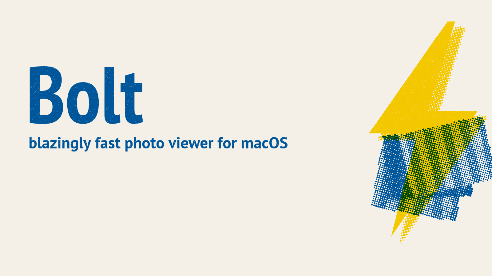

**English** · [Русский](README.ru.md)

A native photo viewer for macOS. Open one photo and flip through the whole folder. Every file action takes one key and can be undone with ⌘Z.

Swift 6 and AppKit, system decoders (ImageIO and Core Image), no third-party dependencies. Licensed under GPLv3.

How it works and how the speed was measured is described in [the article](habr/article.en.md).

## Building

You need macOS 14+ and Swift 6. The Command Line Tools are enough, Xcode isn't required.

```bash
scripts/build-app.sh            # build/Bolt.app, release
scripts/build-app.sh debug
scripts/test.sh                 # 83 unit tests of the core (Swift Testing)
scripts/ui-smoke.sh             # 19 checks of the built app with real key presses
scripts/check-strings.py        # strings missing from translations
scripts/translate.py de fr      # fill them with Claude Haiku
```

The script signs the app ad hoc and registers it with Launch Services, so Bolt shows up in "Open With". To distribute it you need a Developer ID: `SIGN_IDENTITY="Developer ID Application: …" scripts/build-app.sh`, then notarize with `notarytool`.

Test photos: `swift scripts/make-test-photos.swift ~/Desktop/test 400 --broken` creates 400 12 MP HEIC files with EXIF and GPS, bursts of similar shots, blurry shots, portrait shots with Orientation 6 and a few broken files.

## Features

**Viewing.** A file from Finder opens right away, the rest of the folder is read in the background. Zoom: fit, 100% (pixel for pixel), fit width, pinch toward the cursor. Zoom and position stay put as you flip, so it's easy to check a burst for sharpness. Its own full screen mode without the Spaces animation. Thumbnail grid and filmstrip, EXIF panel, side-by-side comparison of 2–4 photos with shared zoom, animated GIF/APNG/WebP, video without autoplay, Live Photo while V is held, HDR on EDR displays. New files in the folder are picked up automatically.

**Culling.** Delete moves the photo to the Trash and shows the next one at once, with no dialog. Digits 1–9 move the photo to assigned folders, with ⌥ they copy it. If a digit isn't assigned yet, a folder picker with fuzzy search opens, and you can type a new name there too. Flags P/X/U, ratings ⌃1–5 and color labels ⌃6–9 are stored in Finder tags, the files themselves are not touched. Filter by label: show the rejects, select all (⌘A), delete. RAW+JPEG pairs, Live Photo halves and iPhone IMG_E copies move together.

**Editing.** Rotate [ ] and flip H only change the Orientation tag, the pixels stay byte for byte the same (a test checks this). Crop C with aspect ratios. Export E with the last preset ("Telegram: JPEG 85%, 2560 px, no location"), ⇧E picks a preset. Batch conversion, resizing and renaming by a template like `{date:yyyy-MM-dd_HHmmss}_{counter:3}`, with a preview. Removing location and serial numbers without re-encoding.

No operation deletes a file without going through the Trash or overwrites an existing one: on a name clash you get " (2)". Edits are saved as a copy next to the original by default. The "replace original" mode first moves the original to the Trash, so ⌘Z brings everything back.

**Languages.** The interface is in 15 languages. Bolt follows the system language, and another one can be picked in Settings → General. Russian was written by hand; the other 13 were translated by Claude Haiku with `scripts/translate.py` and may read awkwardly in places.

## Keys

Keys are bound to physical key codes, so they also work with a Russian or other non-Latin layout. `?` shows a cheat sheet, `/` or ⌘K opens a palette with every command. Settings have Bolt, IrfanView and Lightroom profiles, and any key can be remapped.

| | |
|---|---|
| ← → Space | flip |
| Home End PgUp PgDn | first, last, by 10 |
| ⌘← ⌘→ ⌘↑ | neighboring folder, parent folder |
| G T I | grid, filmstrip, info |
| F Esc Tab | full screen, exit, hide interface |
| Z = − W | fit ⇄ 100%, zoom, fit width |
| ⌫ | to Trash |
| 1–9, ⌥1–9, ⌘⇧1–9 | move, copy, assign folder |
| M ⇧M | move to any folder, copy to any folder |
| P X U, ⌃0–5, ⌃6–9 | flag, rating, color label |
| ⇧← ⇧→ | extend selection |
| K | compare |
| . | repeat last action |
| ⌘Z ⌘⇧Z | undo, redo |
| ↩ or F2 | rename |
| [ ] H C | rotate, flip, crop |
| E ⇧E | export with preset, choose preset |
| ⌘C ⌘⇧C ⌘R S O | copy photo, path; show in Finder; share; open in editor |

## How it works

`Sources/BoltCore`: everything that can be tested without a window: folder listing via `getattrlistbulk`, natural sorting, the filmstrip model (`Gallery`), zoom geometry (`Viewport`), the decoder, an LRU cache, the undoable file operation log (`FileHistory`), export, labels, the rename template. Tests live in `Tests/BoltCoreTests`.

`Sources/Bolt`: the AppKit app, SwiftUI only in settings and dialogs.

This is how a frame gets shown. A key moves `Gallery`, `displayCurrent` puts the best ready frame from the cache into `CALayer.contents`, and `scheduleFrames` asks `FrameLoader` for the current photo and its neighbors: 3 ahead and 1 behind in the direction of travel, and after Page Down also the photo 10 further on. The neighbors start decoding once the current photo is ready. HEIC and JPEG are decoded by Core Image (`CoreImageFrames`): straight to screen size, on the GPU, into an `IOSurface` that the layer shows without a copy, about 17 ms for an iPhone photo. On an EDR display, photos with a gain map get HDR up to the display's headroom, in half float, which takes twice the memory. Other formats, the full-size frame for 100% zoom and anything Core Image trips on go through ImageIO (`CGImageSourceCreateThumbnailAtIndex`). If the frame isn't in the cache (the first Page Down), the window goes blank for a moment, the embedded preview is read in the background and shows up in 10–20 ms, and the sharp frame arrives in 30–45 ms. A held arrow key works the same way as separate presses: the decoder keeps up with key repeat. Work that is no longer needed is cancelled, so the queue doesn't pile up.

File operations are optimistic. The photo leaves the filmstrip at once, and the actual move runs on a single serial queue. If it fails, the photo comes back and a toast shows the reason. Undo goes into the same queue, so ⌘Z right after Delete runs after the deletion itself. Long batches run in parallel on all cores and land in the history as one step.

## Measurements

MacBook Air 15″ (Apple M5, 16 GB), macOS 27, 60 Hz display, release build. Photos: 200 12 MP HEIC files from an iPhone 13, nearly all with an HDR gain map, unless the row says otherwise. The scenarios run inside the app through the debug channel (below).

| | Target from the spec | Measured |
|---|---|---|
| Cold start to first frame | < 250 ms | ~150 ms, sharp frame at ~175 ms (about 500 ms on the first launch after a rebuild) |
| Frame change while flipping, median / p95 | < 16 / < 50 ms | 1.2 / 2.2 ms from key to the transaction with the photo, 41 / 49 ms to the photo on screen, frame already decoded |
| Held arrow key | ≥ 30 fps | 30 and 62 photos/s, a sharp photo at every step, ~1 ms of main thread per frame |
| HEIC → JPEG conversion | 1000 photos < 60 s | 400 synthetic photos in 9 s |
| Memory while flipping | cache ≤ 1 GB | 140–390 MB |
| Memory when idle | < 150 MB | 104 MB on synthetic HEIC: in the background the cache shrinks to the neighboring frames |

Of the 41 ms, 1.2 ms is Bolt itself. The rest of the time the frame waits for WindowServer and travels through it to the screen.

Not tested on an M1 with 8 GB. Cold start is the first thing worth checking there.

This is how the cold start works. Creating `NSApplication` takes ~50 ms, and during that time the HEVC decoder and Core Image warm up on other cores: the first HEIC in a process spends ~100 ms setting up the decoder, so a tiny file from the bundle gets decoded first. The photo starts decoding before the window is built, and the preview is read in the background while the window is being built. The window moves into place before its content goes in, so it isn't laid out twice. The status bar is laid out by hand, without Auto Layout. The grid, filmstrip, EXIF panel and comparison view are created only when first shown. The menu is built once the window with the photo is on screen. The time of each step is written to `launch-<pid>.json` if you set `BOLT_LAUNCH_TIMELINE=<folder>`; the benchmark passes it like this: `--open-only --launch-env BOLT_LAUNCH_TIMELINE=/tmp/tl`.

### Comparison with other viewers

Time from a key press (or opening from Finder) to a sharp photo in a screen recording. The benchmark presses keys itself with synthetic events and finds the moment the right photo appears in the recording. Photos: 202 HEIC files from an iPhone 13, 193 of them with an HDR gain map. Every app had a 1400 × 870 window and three rounds in shuffled order. One Mac: MacBook Air 15″ with Apple M5 and 16 GB, macOS 27, 60 Hz display.

In our measurements Bolt flips faster than Preview, Quick Look, XnView MP and ApolloOne. Photo Mechanic, FastRawViewer and other viewers were not tested.

Presses once every 1000, 400 and 150 ms, 90 of each. Held arrow: three seconds, first repeat after 500 ms, then every 83 ms. Opening from Finder: the app is closed and the benchmark opens a file in it. Median, p95 in parentheses, ms.

| | Bolt | ApolloOne 5.1⁷ | XnView MP 1.12.2 | Preview 11 | Quick Look |
|---|---:|---:|---:|---:|---:|
| Press every 1000 ms | 31 (49) | 87 (123) | 116 (134) | 140 (166) | 172 (224) |
| Every 400 ms | 26 (36) | 64 (84) | 107 (131) | 123 (145) | 167 (247) |
| Every 150 ms | 27 (35) | 64 (85) | 229 (486)¹ | 156 (247)¹ | 197 (238)¹ |
| Held arrow, photos per second | 10.3 | 6.2 | 2.7 | 6.7 | 0.3² |
| How many of them sharp | 100% | 100% | 100% | 6% | —² |
| After release, until sharp frame | 0 | 137 | 780 | 407 | —² |
| Open from Finder, photo appears | 291 (872) | 2119 (3326)³ | 674 (1140) | 2300 (7765)⁴ | 237 (649)⁵ |
| Open from Finder, sharp frame | 350 (1938)⁶ | 2119 (3623)³ | 674 (1140) | 8250 (13457)⁴ | 637 (1016)⁵ |

¹ These can't keep up. On 59 presses out of 90 XnView MP didn't change the picture before the next press, on 50 out of 90 Preview never got the photo sharp, and on 29 out of 90 Quick Look didn't show the photo.

² With synthetic key repeat Quick Look stayed on one photo while the selection in Finder moved. Not checked with a real keyboard.

³ Including app launch and the trial check. ApolloOne is paid, we measured the trial.

⁴ Preview only pages through files opened together, so it was given all 202 at once. Its time includes loading all the files.

⁵ Quick Look was opened with the space bar in an already open Finder window, it doesn't launch an app.

⁶ In two openings after a pause the HDR photo took about a second to reach full brightness, and the benchmark waited for it. This has been fixed, the screen measurement wasn't repeated after the fix.

⁷ Flipping and the held arrow for ApolloOne are counted from two rounds of three: in the first one its filmstrip was open, and 57 presses out of 90 didn't change the photo.

When opening from Finder Bolt isn't first: Quick Look shows the photo sooner, and in the worst cases the sharp frame arrives later than in Quick Look and XnView MP.

The benchmark recognizes a sharp photo by a reference. At the end of a round it goes through every shown photo in the same app, waits 0.6 s on each and stores the settled picture. A recorded frame counts as sharp when it has at least 0.9 of the reference's detail and its brightness is within 2 levels out of 255. XnView ran with default settings.

The screen recording and the probe inside the app use different clocks, which is why Bolt has 31 ms here and 41 ms in the measurements above. The table is good for comparing apps, the probe gives the absolute time.

To reproduce: run `Benchmarks/build-viewer-bench.sh`, allow `build/BoltBench.app` Screen Recording and Accessibility in Privacy & Security settings, and run it on a folder of photos outside `~/Documents`, `~/Desktop` and `~/Downloads`:

```bash
Benchmarks/run-viewer-bench.sh ~/bench-photos /tmp/bench-results 3 --generic
```

A run takes over the screen for about four minutes per app, apps that aren't installed are skipped. Without `--generic` the script measures only Bolt, XnView MP and Preview, on synthetic photos from `Benchmarks/make-bench-photos.swift`, and recognizes them by color. BoltBench only launches `build/viewerbench`, so you can rebuild the tool without granting the permissions again.

## Command line

The app contains `bolt` for scripts and for the "Run Shell Script" action in Shortcuts:

```bash
ln -s /Applications/Bolt.app/Contents/Helpers/bolt /usr/local/bin/bolt
bolt convert *.HEIC --format jpeg --size 2560 --strip-location --out ~/Desktop/Telegram
bolt rename *.HEIC --template "{date:yyyy-MM-dd_HHmmss}_{counter:3}" --dry-run
```

## Debug channel

`Bolt --debug-control` takes commands through distributed notifications: press a key (a real event through the queue, along with the key monitor), save a PNG of the window, dump the state to JSON, run the flipping benchmark. Send them like this:

```bash
swiftc -O scripts/boltctl.swift -o .build/boltctl
open -a build/Bolt.app ~/Desktop/test/IMG_1.HEIC --args --debug-control
.build/boltctl key 124                 # →
.build/boltctl bench 150 250 /tmp/bench.json
.build/boltctl state /tmp/state.json
```

Without the flag the channel is off.

Three commands measure the time from an arrow press to a sharp frame: `taps <steps> <ms> <file.json> [pgdn] [turn=<n>] [back]` (separate presses once every `ms`; `pgdn` presses Page Down, a step of 10 photos; `turn=<n>` goes n steps forward and then back), `first <ms> <file.json>` (one press `ms` after the first frame of the opened photo) and `hold <steps> <ms> <file.json> [delay=<ms>] [back]` (a held arrow: a press without repeat, the first repeat after `delay`, one interval by default, then a repeat every `ms`, release half an interval after the last one). The events are real, through the queue and the key monitor, and go out on schedule without waiting for the app, so a slow step shows up as a delay and a burst of steps. For each press it records: how many milliseconds after the press the sharp frame of that photo was in the layer, which frame was on screen right away (`none`, `preview`, `screen`, `full`), whether it was HDR and how many bytes it takes, and what the main thread's step was made of: before showing, showing together with the transaction commit, after showing, the commit at the end of the run loop pass. There is one hook, `ImageCanvasView.onShown`, called before and after the frame changes and set only for the duration of a run. `scripts/scroll-bench.sh <photos> <results>` runs every scenario (presses once every 1000, 400, 150 and 60 ms, a first press 300 ms and 2 s after opening, a turnaround, Page Down jumps, held keys at 90, 33 and 16 ms), each in a new process with an empty frame cache, and prints tables over all presses of all rounds; with `--baseline <commit>` it builds that commit from a `git worktree` and alternates it with the working copy, with cells reading "base → new". The script clones the photos into a temporary folder and refuses folders in `~/Documents`, `~/Desktop` and `~/Downloads`: an app started with `open` can't read them without an access prompt, reading the folder silently hangs, and so does every process that touches that folder.

## Not done

- Notarization and Sparkle. They need a Developer ID and an update signing key, the build is signed ad hoc.
- Actions for the Shortcuts app (App Intents). Intent metadata is built by Xcode, and only the Command Line Tools were available here.
- WebP export: ImageIO reads it but can't write it. Conversion supports JPEG, HEIC, AVIF, PNG and TIFF.
- A GPS mini map. A map would go to the network, and the spec allows the network only for updates. Instead there are coordinates and an "Open in Maps" button.
- Tiles for images over 100 MP. The full-size frame is capped at 16,384 px on the long side (the texture limit), which is enough for about 180 MP at 3:2.
- Most of P2: duplicates and bursts by perceptual hash, Vision suggestions, histogram and focus peaking. From P2, the slideshow (⌘⌥S), sorting into dated folders and the CLI are done.
- UI tests in XCTest. Instead there is `scripts/ui-smoke.sh`: the built app goes through the main scenarios with real key presses (flipping, Trash and undo, bucket folders, renaming, rotation, flag, grid, comparison, full screen), and the script checks the result. It doesn't run in CI because it needs a screen.

## License

Copyright (C) 2026 Boris Timofeenko. Bolt is licensed under the GNU General Public License v3.0 (`GPL-3.0-only`). You may use, change and redistribute the code, but a program built on it must be released under the same license, so it can't go into closed-source software. The full text is in [LICENSE](LICENSE).
