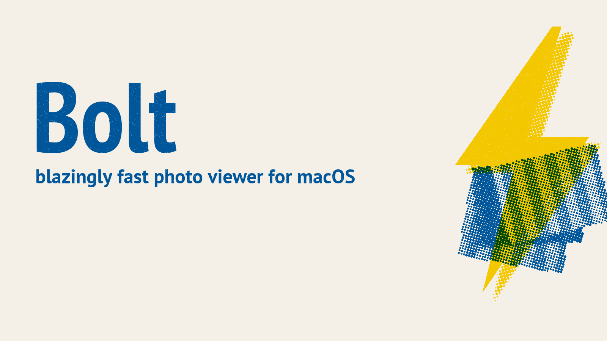
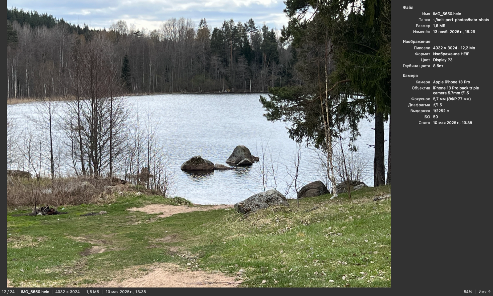
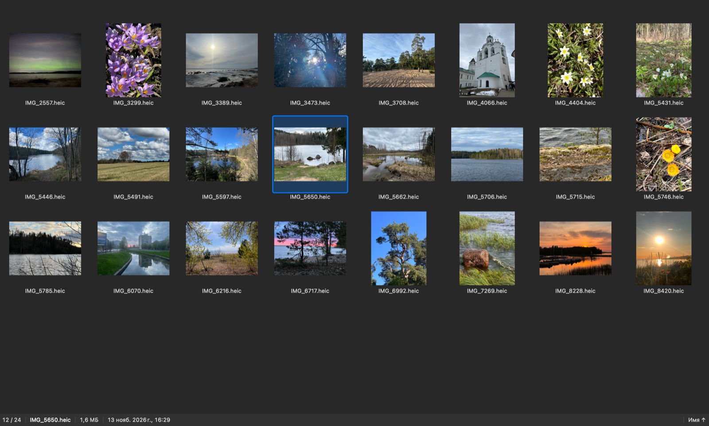
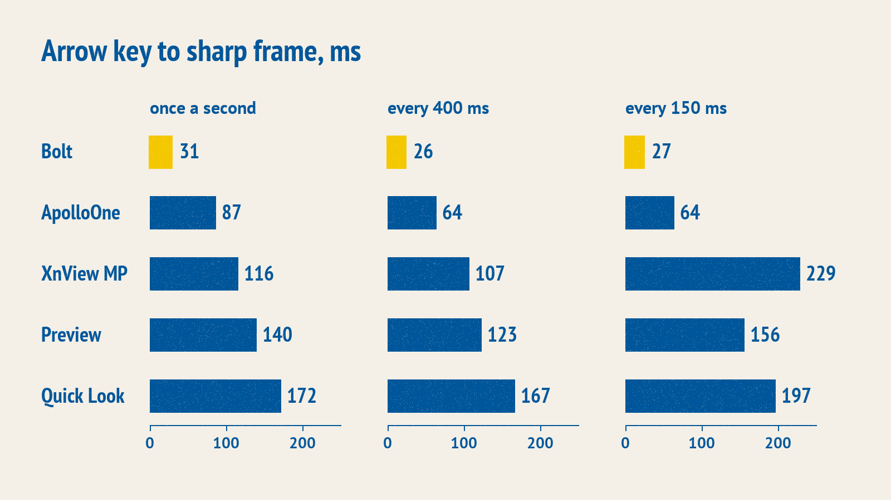
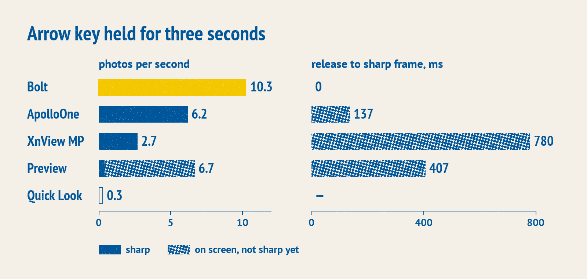
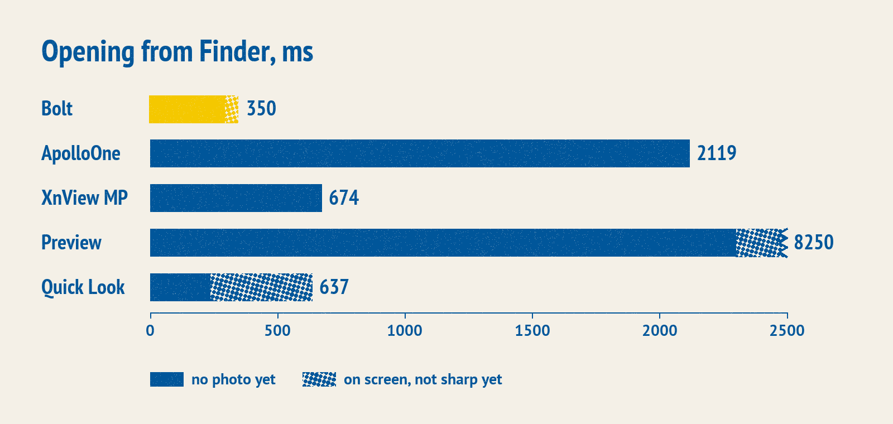
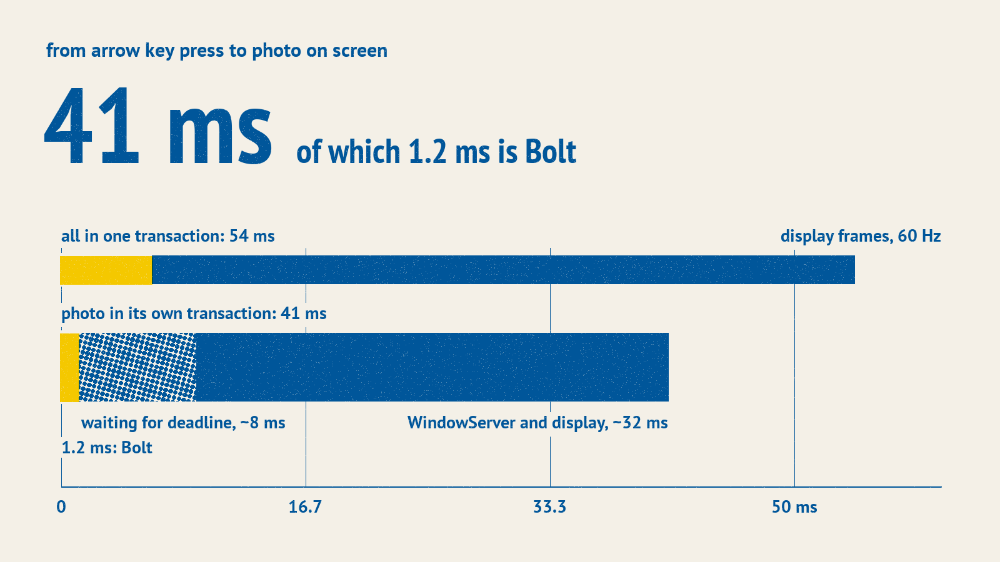

# How I vibe-coded what is probably the fastest photo viewer for macOS

I imported a big batch of HEIC photos from my iPhone. It turned out that even on a modern MacBook there was nothing to flip through them with. The built-in Preview and third-party apps showed the next photo with a delay. The apps themselves didn't open right away either: noticeable time passed between a double-click in Finder and the photo on screen. In past years I would have grumbled a bit, complained about developers who have forgotten how to write fast code, and put up with it, because back then nobody would have bothered writing their own viewer over delays like these. But we live in a new era!

Three evenings, the new Fable 5.2 model with Opus 5.5 subagents, and look, here is Bolt, a native viewer in Swift and AppKit with no third-party dependencies.

In my measurements Bolt flips photos faster than Preview, Quick Look, XnView MP and ApolloOne. The closest of them, ApolloOne, shows the next photo more than twice as slowly.



I optimized for two things. The first is cold start: the time from a double-click in Finder to the photo on screen. The second is switching to the next photo: the time from pressing the arrow key to a sharp frame. What matters is the latency after a single press, not the number of photos per second on a held arrow key. Cold start takes about 350 ms. From the arrow key press to the photo on screen it takes 41 ms, and Bolt itself accounts for 1.2 ms of that. The rest of the time the frame travels to the screen through macOS, and I couldn't make that path shorter.

## What the app is

For the UX I took inspiration from IrfanView, an app many people know from Windows. It has been around since 1996, and its website still says "Fast and compact (just 8 MB)". I wanted to bring a similar experience to the Mac: open one photo, flip through the whole folder, and do everything from the keyboard with as few key presses as possible.

The app turned out very simple. Delete sends the photo to the Trash and immediately shows the next one. There is no confirmation dialog, but any file action can be undone with ⌘Z. The digits 1 to 9 move the photo to assigned folders. The square brackets rotate the photo, and only the Orientation tag changes while the pixels stay byte for byte the same. There is export by preset and batch operations: conversion, resizing, renaming by template. There is also a grid that shows all the photos in the folder.



*Photo and info panel, key I. The interface is shown in Russian.*



*Folder grid, key G.*

Bolt is not a cataloging tool. It doesn't replace Lightroom and other apps that manage a library of your photo albums. It works at the folder level, and its strength is simplicity. I sort my photos into folders. I think this approach is more fault-tolerant and doesn't depend on anything. Bolt doesn't replace a full editor either.

Now I use it every day and have made it my default viewer.

## How I measured

You can't ask someone else's app to report when it showed a frame. So the benchmark watches the screen. It records the screen with ScreenCaptureKit, presses the keys itself and looks for the moment in the recording when the right photo appeared.

Photos: 202 of them from my iPhone 13 archive. 193 of them have a gain map: a second image inside the HEIC that says where and by how much to raise brightness. On a screen with headroom such photos are shown as HDR. Headroom is how many times brighter than normal white the screen can get. On this MacBook it is 2.0. Below you'll see why this matters.

A reference helps recognize the photos in the recording. At the end of its round the benchmark goes through all the shown photos in the same app, waits 0.6 seconds on each and remembers the settled image. A frame of the recording counts as sharp when it has at least 0.9 of the reference's detail and its brightness differs by no more than 2 levels out of 255. The preview, a reduced copy of the photo embedded in the file, doesn't pass this threshold: it's blurry.

Five apps: Bolt, ApolloOne 5.1 Trial, XnView MP 1.12.2, Preview 11 and Quick Look. ApolloOne is paid, so we measured its trial version. The window is 1400 × 870 for all of them. Each app ran three rounds in shuffled order. One computer: MacBook Air 15″ with Apple M5 and 16 GB of memory, macOS 27, 60 Hz screen.

The table below covers five scenarios. In three of them the arrow key is pressed 90 times: once a second, every 400 ms and every 150 ms. In the fourth the arrow key is held for three seconds. The first repeat comes after 500 ms, then presses come every 83 ms, like system autorepeat. In the fifth the app is closed, and the benchmark opens a file in it from Finder.







*The charts show medians. The same numbers with the 95th percentile and footnotes are in the table below.*

All numbers in the table are the median, with the 95th percentile in parentheses, in milliseconds.

| | Bolt | ApolloOne⁷ | XnView MP | Preview | Quick Look |
|---|---:|---:|---:|---:|---:|
| Press every 1000 ms | 31 (49) | 87 (123) | 116 (134) | 140 (166) | 172 (224) |
| Every 400 ms | 26 (36) | 64 (84) | 107 (131) | 123 (145) | 167 (247) |
| Every 150 ms | 27 (35) | 64 (85) | 229 (486)¹ | 156 (247)¹ | 197 (238)¹ |
| Held arrow key, photos per second | 10.3 | 6.2 | 2.7 | 6.7 | 0.3² |
| How many of them sharp | 100% | 100% | 100% | 6% | —² |
| From release to sharp frame | 0 | 137 | 780 | 407 | —² |
| Opening from Finder, photo appeared | 291 (872) | 2119 (3326)³ | 674 (1140) | 2300 (7765)⁴ | 237 (649)⁵ |
| Opening from Finder, sharp frame | 350 (1938)⁶ | 2119 (3623)³ | 674 (1140) | 8250 (13457)⁴ | 637 (1016)⁵ |

1. These apps can't keep up. In XnView MP, on 59 presses out of 90 the image didn't change before the next press. In Preview, on 50 presses out of 90 the photo didn't become sharp. Quick Look didn't show the photo on 29 presses out of 90.
2. With synthetic autorepeat Quick Look stayed on one photo, although the selection in Finder moved. I did not check this on a real keyboard, so there is no conclusion here.
3. Including the app launch and the trial version check.
4. Preview only flips through files opened together, so it was given all 202 at once. Its time includes loading all the files, and it isn't directly comparable with the others.
5. Quick Look was opened with the space bar in an already open Finder window. It doesn't launch an app.
6. In two openings after a pause the HDR photo took about a second to reach full brightness, and the benchmark waited for the final one. Now the frame is shown at its final brightness right away. The screen series wasn't repeated after that.
7. Flipping and the held arrow key for ApolloOne are counted over two rounds out of three. In the first one it had the thumbnail strip open, and 57 presses out of 90 didn't change the photo.

When flipping, Bolt is faster than everything we measured. Its 95th percentile is below the median of any of the other four apps. When opening from Finder it isn't first. Quick Look shows the photo earlier, at 237 ms versus 291 ms. And in the worst cases Bolt's sharp frame on opening arrives later than in Quick Look and XnView MP. The reason is in footnote 6.


## 41 ms from key press to screen: how much of it depends on Bolt

From the arrow key press to the photo on screen it takes 41 ms, while the comparison table lists 31 ms for Bolt. These are different clocks. In the table the count goes from a synthetic key press to the frame in the screen recording. But the screen recording, judging by calibration, sees a frame earlier than the panel shows it. The recording notices a background color change 21–33 ms after the command, while by the system's timestamp the frame takes 40 ms to reach the screen. So the table is good for comparing apps, and only a measurement from inside the app gives the absolute time.

For that measurement the agent built a probe into Bolt. The probe sends the app a key event, and together with the photo, in the same Core Animation transaction, puts a 2-point Metal layer into the window. A transaction is a batch of layer changes that the app sends to WindowServer in one go. A Metal layer can be asked for `presentedTime`, the moment the frame was shown, and that time is set by the system, not by the app. The measurement was done on photos already in the cache.

First, the probe helped decide what to send in the same transaction as the photo. The obvious choice is everything at once: the photo, the window title, the file icon in the title bar and the status bar. That gives 54 ms, and the photo reaches the screen a frame later than it could, because AppKit lays out and draws the text of the title and the status bar inside the same transaction. The agent removed them one at a time and watched how the time to screen changed.

| Removed from the photo's transaction | To screen, median / p95, ms |
|---|---:|
| Nothing | 55.6 / 63.0 |
| Window title only | 46.1 / 53.8 |
| File icon only | 53.6 / 60.6 |
| Status bar only | 52.2 / 58.1 |
| All three | 42.7 / 49.3 |

*A separate series of 37 presses, so the numbers differ from the final ones by 1–2 ms.*

The main culprit is the window title. Changing it costs the main thread about 1 ms, but without it the photo reaches the screen 9.5 ms earlier, and without all three 13 ms earlier, almost a whole frame. So in Bolt the photo goes out first in its own transaction, and the title and status bar follow in the next one.

```swift
CATransaction.begin()
CATransaction.setDisableActions(true)
imageLayer.contents = newFrame.layerContents
// ...
CATransaction.commit()
// The photo goes to WindowServer in its own transaction.
// The title and status bar follow, at most a frame later.
if window?.isVisible == true { CATransaction.flush() }
```

With a separate transaction it takes 41.4 ms from the key event to the frame on screen, with a shared one 54.1 ms; the 95th percentile is 49.3 ms versus 61.6 ms. These 41 ms split into three parts:

- 1.2 ms passes from the key event to the transaction with the photo. This is all of Bolt's work. With a shared transaction this part takes 6 ms, because the layout and drawing of the title and status bar are added to it.
- From 0 to 16.7 ms, about 8 ms on average, the frame waits for the deadline by which WindowServer assembles the next screen frame.
- Another 31–34 ms passes from that deadline to display. At 60 Hz that's about two frames.



*Time from the key event in the app to the moment the system showed the frame. Median over 111 presses on HDR photos, 60 Hz screen. Yellow is Bolt's work, dotted blue is waiting for the deadline, solid blue is the frame's path through WindowServer to the screen.*

Outside the 41 ms remain the path from the keyboard to the app and the panel's scanout of the frame. By the agent's estimate that's 1–5 ms and about 8 ms plus the panel's response time, but they weren't measured.

So out of 41 ms the app controls only 1.2 ms. The agent checked whether the rest could be shortened. Showing the photo through Metal instead of `contents` gave 43.4 ms versus 41.4 ms. Neighboring frames placed in the layer tree in advance shortened the transaction by 0.7 ms, but changed nothing on screen. The report's conclusion: in a window this path can't be bypassed, either through `contents` or through Metal.

That means all Bolt can do is have the next photo ready as a frame in the cache by the time of the key press. That's the decoder's job.

## Decoder: from 151 ms to 17 ms

For the next photo to appear immediately, it has to be decoded in advance, and the faster one photo decodes, the easier it is to keep the neighbors ready. I managed to cut the decoding time of one iPhone photo from 151 ms to 17 ms. That took switching from one system framework to another: from ImageIO to Core Image.

The natural place to start is ImageIO. It's the standard way to read an image on the Mac: the app gives it a file and gets a ready bitmap back. It understands all the usual formats, HEIC included. On iPhone photos ImageIO turned out to be slow. Without HDR it decodes a photo in 45–47 ms, but iPhone photos have a gain map, and on a screen with headroom ImageIO decodes them as HDR. That takes 140–151 ms. Threads don't help: it doesn't deliver more than 11 photos per second, however many threads you give it.

A profile showed where the time goes. HEVC itself is decoded in hardware, and the time is lost around it. A 12 MP iPhone photo consists of 48 tiles of 512 × 512. For each tile the system framework CMPhoto creates a new pixel transfer session, `VTPixelTransferSession`, and each time asks WindowServer about the main display. A microbenchmark confirmed it: 48 tiles with a new session for each take 23.4 ms, and with one shared session 11.0 ms. On an HDR photo the profile shows roughly 2.6 times more of this work.

Core Image works differently. It's another system framework that processes images on the GPU: color, filters, scaling. People usually call it for filters, but it can read files too. Judging by the stacks, Core Image gets the whole photo from CMPhoto rather than tile by tile, and converts color and scales in one pass on the GPU.

Bolt uses this as follows. It builds a `CIImage` from the file, applies the gain map for the screen's headroom and scales the photo down to the screen size. The result is rendered into an `IOSurface`, a buffer that the layer displays without copying.

```swift
var image = CIImage(cgImageSource: source, index: 0, options: [.applyOrientationProperty: true])
// ...
let gainMap = CIImage(cgImageSource: source, index: 0,
                      options: [.applyOrientationProperty: true, .auxiliaryHDRGainMap: true])
// ...
image = image.applyingGainMap(gainMap, headroom: Float(headroom))
// ... scale to the screen, then render into IOSurface
try context.startTask(toRender: image, to: destination).waitUntilCompleted()
```

This way one photo decodes in 16–17 ms including HDR, and threads start to help. The table shows the number of HDR photos per second for both frameworks with different numbers of threads.

| Threads | 1 | 2 | 4 | 6 | 8 |
|---|---:|---:|---:|---:|---:|
| ImageIO, HDR, photos per second | 6 | 10 | 11 | 7 | 11 |
| Core Image, HDR, photos per second | 59 | 88 | 112 | 117 | 118 |

ImageIO tops out at 11 photos per second, while Core Image reaches 118. In a one-minute run on four threads it holds 110 photos per second. The agent checked the result against ImageIO on 400 photos: size and orientation matched on all of them.

ImageIO in Bolt still handles PNG, GIF, TIFF, RAW, animations and the full-resolution frame when zooming. Bolt also falls back to it when Core Image can't cope: CMYK, grayscale and HDR without a gain map.

The agent checked one more option and shelved it: a custom decoder on VideoToolbox. The prototype showed a hardware ceiling of 147 photos per second, and that's only decoding the tiles, without assembly and scaling. Core Image without HDR gives 131, so the gain would have been no more than 12%, and building such a decoder wasn't worth it.

With this decoder, flipping works differently too.

## Flipping: a sharp frame at every step

When the frame is ready in advance, on an arrow key press Bolt only moves the index in the list, takes this photo's frame from the cache and puts it into the layer's `contents`. There is no drawing in the app: showing a frame is a single swap of the layer's contents with animation turned off.

Bolt keeps three photos ready ahead in the direction of movement and one behind. The "ahead" depth was picked by measuring with autorepeat every 16 ms: with two photos ahead a sharp frame was there immediately on 87–98% of steps, with three on 98–100%. With five it was there on every step, but the process memory grew by another 100 MB.

The hardest case is the held arrow key. The cheapest way to survive it is to show only the preview while the key is held and decode the sharp frame after release. With ImageIO there is no other way: on HDR photos it delivers at most 11 photos per second, while autorepeat asks for 12. With a 17 ms decoder such a mode isn't needed, and Bolt doesn't have it. Below are both approaches at different autorepeat rates.

| Autorepeat every | 90 ms | 60 ms | 33 ms | 16 ms |
|---|---:|---:|---:|---:|
| Steps with a sharp frame immediately: ImageIO and preview mode | 99–100% | 4% | 4% | 4% |
| Core Image without preview mode | 100% | 100% | 100% | 99–100% |

Autorepeat every 16 ms is 62 photos per second, and even at that rate Core Image without preview mode gives a sharp frame on almost every step. In preview mode the sharp frame appears 211–217 ms after the key is released, measured inside the app, while without this mode it's already on screen.

Bolt pays for the fast decoder with memory. An HDR frame is stored in half float and takes 29 MB for a portrait photo and 52 MB for a landscape one, while a frame from ImageIO takes 14–26 MB. Freeing a large frame costs the main thread milliseconds on every step, so evicted frames are freed by a background queue. The cache holds only what was requested: the current photo, one behind and three ahead. Peak process memory while flipping came out at 388 MB.

The frame's path through the system can't be shortened, but the app's own work can be done in advance. Launch works the same way.

## Cold start: working while the system makes you wait

Cold start here means a double-click on a photo in Finder when Bolt isn't running. Bolt has a built-in launch timeline that records the time of each step from process start. It shows that most of the time before the window is taken by the system. It takes 37 ms to reach `main`, although the binary itself, launched directly, reaches `main` in about 11 ms, and creating `NSApplication` takes about another 50 ms. Like the frame's path through WindowServer, this is time Bolt can't shorten. But during this time it can work on other cores. There are three tricks.

- Warming up the decoder. By the agent's measurements the first HEIC in a process's life decodes about 100 ms slower than the following ones. So the bundle contains a `warmup.heic` of 16 × 16 pixels and 2324 bytes, and Bolt sends it for decoding at the very start of `main`, before `NSApplication` is created.
- Decoding before the window. The window constructor first queues reading the preview and decoding the sharp frame, and only then creates the views.
- Order on the main thread. The empty window moves to its saved position before the content is inserted: that way the move costs 7–8 ms, and with content 26 ms. The menu is built after the photo is shown, that's about another 11 ms.

The warm-up at the start of `main` looks like this.

```swift
MainActor.assumeIsolated {
    LaunchTimeline.mark("main")
    LaunchWarmUp.start()                     // decodes warmup.heic on another core
    let application = NSApplication.shared   // about 50 ms of system work
    // ...
}
```

On real photos the sharp frame is ready 176 ms after process start according to the timeline, over 12 launches. The comparison table lists 350 ms, and again these are different clocks, as with 31 and 41 ms for flipping: there the count goes from the command to open the file to the frame in the screen recording.


## Vibe coding and small utilities

Bolt fills a small niche. Every system has a photo viewer, there are plenty of third-party ones, and the difference between them ranges from tens of milliseconds when flipping to seconds when opening. In the past nobody would have bothered over a difference like that. This article alone has three ideas that gave nothing or didn't pay off. Each of them had to be built, measured and compared. On top of that it took a benchmark that measures other people's apps from a screen recording, a probe inside the app, digging through other apps' bundles and a profile of XnView MP.

The agent made mistakes along the way. The first benchmark measured synthetic photos without a gain map and missed the slow HDR path in ImageIO.

Things like this can be done with vibe coding. It works especially well on compact utilities. Bolt has about 10 thousand lines and no dependencies, and it doesn't suffer from a bloated codebase.

I think there are still plenty of unfilled niches of this size.

## Where to find it?

The repository on GitHub:
https://github.com/boris-timofeenko/bolt

The page on my website:
https://projects.b0ris.net/bolt/
