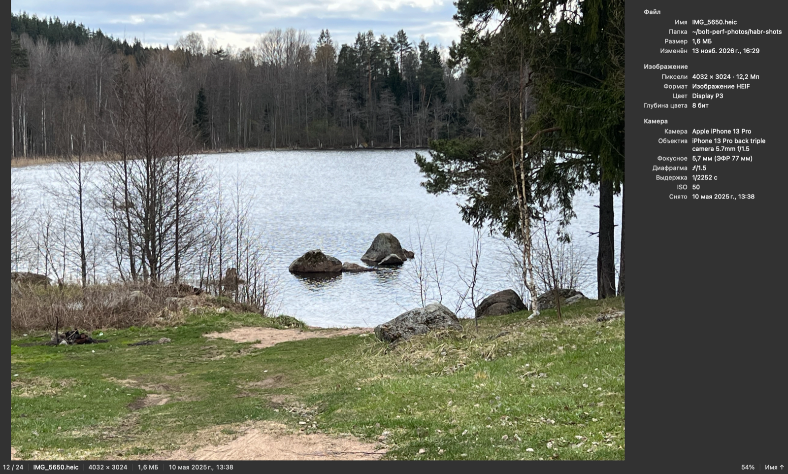
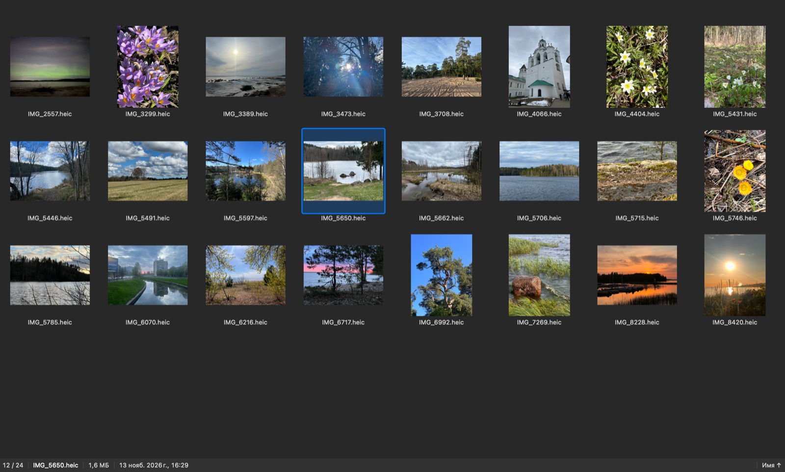
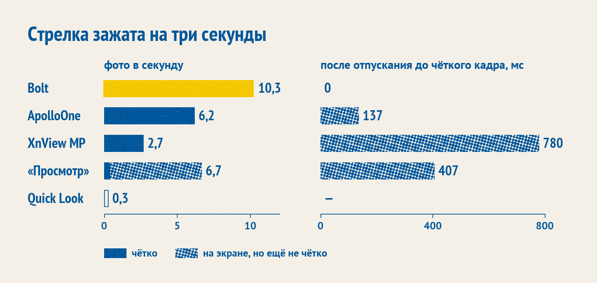
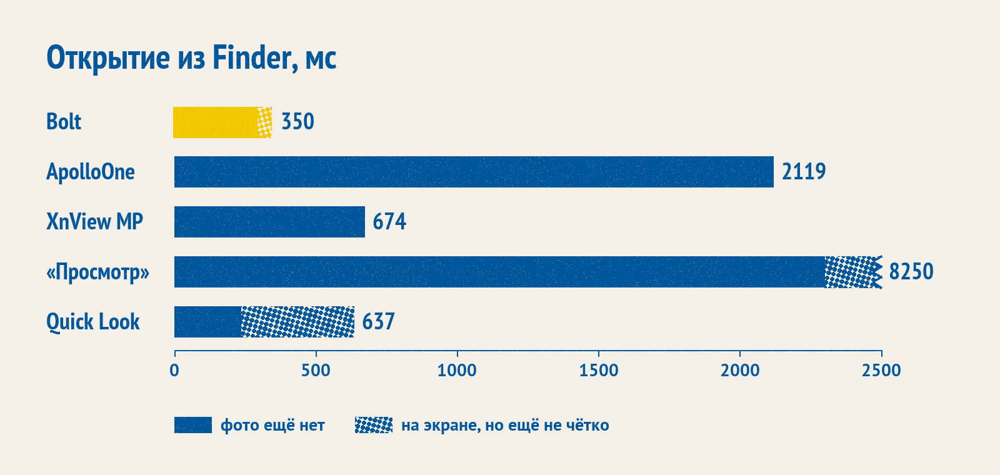
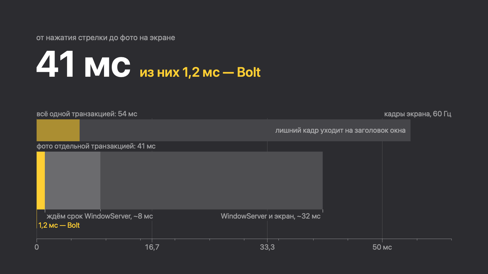

# Как я навайбкодил, вероятно, самый быстрый просмотрщик фото для macOS

Я импортировал со своего айфона большую пачку фотографий в HEIC. Оказалось, что даже на современном макбуке листать их нечем. Встроенный «Просмотр» и сторонние программы показывали следующее фото с задержкой. Сами программы тоже открывались не сразу: между двойным кликом в Finder и фотографией на экране проходило заметное время. В прошлые года, я бы немного поплевался, посетовал на разучившихся писать быстрый код девелоперов, и смирился бы, ведь раньше ради таких задержек никто бы не стал заморачиваться и писать свой просмотрщик. Но мы же живём в новой эпохе!

Три вечера, новая модель Fable 5.2 с саб-агентами на Opus 5.5, и вот смотрите, получился Bolt, нативный просмотрщик на Swift и AppKit без сторонних зависимостей.

В моих замерах Bolt листает быстрее «Просмотра», Quick Look, XnView MP и ApolloOne. Ближайший из них, ApolloOne, показывает следующее фото в два с лишним раза медленнее. 


Оптимизиация шла по двум параметрам. Первый это холодный старт: время от двойного клика в Finder до фото на экране. Второй - переключение на следующее фото: время от нажатия стрелки до чёткого кадра. Важна именно задержка после одного нажатия, а не число фото в секунду при зажатой стрелке. Холодный старт занимает около 350 мс. От нажатия стрелки до фото на экране проходит 41 мс, и на сам Bolt из них приходится 1,2 мс. Остальное время кадр идёт к экрану через macOS, и сократить этот путь не получилось.

<cut />

## Что это за программа

В части UX я вдохновлялся IrfanView, программой, знакомой многим по Windows. Она выходит с 1996 года, и на её сайте до сих пор написано: «Fast and compact (just 8 MB)». Мне хотелось перенести на Mac похожий опыт: открыл одно фото, листаешь всю папку, и всё делается с клавиатуры минимальным количеством нажатий.

Программа получилась очень простая. Delete отправляет фото в Корзину и сразу показывает следующее. Диалога подтверждения нет, зато любое действие с файлом отменяется через ⌘Z. Цифры от 1 до 9 перемещают фото в назначенные папки. Квадратные скобки поворачивают фото, при этом меняется только тег Orientation, а пиксели остаются байт в байт. Есть экспорт по пресету и пакетные операции: конвертация, изменение размера, переименование по шаблону. Ещё есть сетка, в которой видны все фото папки.



*Фото и панель данных, клавиша I.*



*Сетка папки, клавиша G.*

Bolt это не инструмент для каталогизации. Он не заменяет Lightroom и другие программы, которые ведут библиотеку ваших фотоальбомов. Он работает на уровне папки, и его сила в простоте. Свои фото я раскладываю по папкам. Мне кажется, такой подход отказоустойчивее и ни от чего не зависит. Полноценный редактор Bolt тоже не заменяет.

Теперь я пользуюсь им каждый день и поставил просмотрщиком по умолчанию.

## Методика измерений

Чужую программу нельзя попросить сообщить, когда она показала кадр. Поэтому бенчмарк смотрит на экран. Он записывает экран через ScreenCaptureKit, сам нажимает клавиши и ищет в записи момент, когда появилось нужное фото.

Фото : 202 штуки из моего архива с iPhone 13. У 193 из них есть карта усиления (gain map): второе изображение внутри HEIC, которое говорит, где и насколько поднять яркость. На экране с запасом яркости такие фото показываются как HDR. Запас яркости  это то, во сколько раз экран может светить ярче обычного белого. У этого макбука он равен 2,0. Ниже будет видно, почему это важно.

Узнавать фото в записи помогает эталон. В конце своего круга бенчмарк проходит в той же программе по всем показанным фото, ждёт на каждом 0,6 секунды и запоминает установившуюся картинку. Кадр записи считается чётким, когда деталей на нём не меньше 0,9 от эталона, а яркость отличается не больше чем на 2 уровня из 255. Превью, встроенная в файл уменьшенная копия фото, этот порог не проходит: оно размытое.

Программ пять: Bolt, ApolloOne 5.1 Trial, XnView MP 1.12.2, «Просмотр» 11 и Quick Look. ApolloOne платный, мерили его пробную версию. Окно у всех 1400 × 870. Каждую программу гоняли три круга в перемешанном порядке. Компьютер один: MacBook Air 15″ с Apple M5 и 16 ГБ памяти, macOS 27, экран 60 Гц.

В таблицу ниже вошли пять сценариев. В трёх стрелку нажимают 90 раз: раз в секунду, раз в 400 мс и раз в 150 мс. В четвёртом стрелка зажата на три секунды. Первое повторение приходит через 500 мс, дальше нажатия идут каждые 83 мс, как при системном автоповторе. В пятом программа закрыта, и бенчмарк открывает в ней файл из Finder.






*На графиках медианы. Те же цифры с 95-м перцентилем и сносками собраны в таблице ниже.*

Все цифры в таблице — медиана, в скобках 95-й перцентиль, в миллисекундах.

| | Bolt | ApolloOne⁷ | XnView MP | «Просмотр» | Quick Look |
|---|---:|---:|---:|---:|---:|
| Нажатие раз в 1000 мс | 31 (49) | 87 (123) | 116 (134) | 140 (166) | 172 (224) |
| Раз в 400 мс | 26 (36) | 64 (84) | 107 (131) | 123 (145) | 167 (247) |
| Раз в 150 мс | 27 (35) | 64 (85) | 229 (486)¹ | 156 (247)¹ | 197 (238)¹ |
| Зажатая стрелка, фото в секунду | 10,3 | 6,2 | 2,7 | 6,7 | 0,3² |
| Сколько из них чётких | 100% | 100% | 100% | 6% | —² |
| После отпускания до чёткого кадра | 0 | 137 | 780 | 407 | —² |
| Открытие из Finder, фото появилось | 291 (872) | 2119 (3326)³ | 674 (1140) | 2300 (7765)⁴ | 237 (649)⁵ |
| Открытие из Finder, чёткий кадр | 350 (1938)⁶ | 2119 (3623)³ | 674 (1140) | 8250 (13457)⁴ | 637 (1016)⁵ |

1. Эти программы не успевают. У XnView MP на 59 нажатиях из 90 картинка не сменилась до следующего нажатия. У «Просмотра» на 50 нажатиях из 90 фото не стало чётким. Quick Look на 29 нажатиях из 90 не показал фото.
2. При синтетическом автоповторе Quick Look остался на одном фото, хотя выделение в Finder двигалось. На живой клавиатуре это не проверено, вывода здесь нет.
3. Вместе с запуском программы и проверкой пробной версии.
4. «Просмотр» листает только файлы, открытые вместе, поэтому ему открывали все 202 сразу. В его время входит загрузка всех файлов, и с остальными оно напрямую не сравнимо.
5. Quick Look открывали пробелом в уже открытом окне Finder. Программу он не запускает.
6. В двух открытиях после паузы HDR-фото около секунды набирало яркость, и бенчмарк ждал итоговой. Сейчас кадр сразу показывается с итоговой яркостью. Экранную серию после этого не повторяли.
7. Листание и зажатая стрелка у ApolloOne посчитаны по двум кругам из трёх. В первом у него была открыта лента миниатюр, и 57 нажатий из 90 не сменили фото.

При листании Bolt быстрее всех, кого мы мерили. Его 95-й перцентиль ниже медианы любой из четырёх других программ. При открытии из Finder он не первый. Фото раньше появляется у Quick Look, через 237 мс против 291 мс. И в худших случаях чёткий кадр при открытии приходит у него позже, чем у Quick Look и XnView MP. Причина в сноске 6.


## 41 мс от нажатия до экрана: что из них зависит от Bolt

От нажатия стрелки до фото на экране проходит 41 мс, а в таблице сравнения у Bolt стоит 31 мс. Это разные часы. В таблице отсчёт идёт от синтетического нажатия до кадра в записи экрана. Но запись экрана, судя по калибровке, видит кадр раньше, чем его покажет панель. Смену цвета фона запись замечает через 21–33 мс после команды, а по отметке системы кадр идёт до экрана 40 мс. Поэтому таблица годится для сравнения программ, а абсолютное время даёт только замер изнутри приложения.

Для такого замера агент встроил в Bolt зонд. Зонд посылает приложению событие клавиши, а вместе с фото, в той же транзакции Core Animation, кладёт в окно слой Metal размером 2 пункта. Транзакция — это пакет изменений слоёв, который приложение отправляет в WindowServer за один раз. У слоя Metal можно спросить `presentedTime`, момент показа кадра, и это время назначает система, а не приложение. Замер шёл на фото, которые уже лежат в кэше.

Первым делом зонд помог решить, что отправлять в одной транзакции с фото. Напрашивается всё сразу: фото, заголовок окна, значок файла в заголовке и строку состояния. Так выходит 54 мс, и фото приходит на экран на кадр позже, чем могло бы, потому что AppKit раскладывает и рисует текст заголовка и строки состояния внутри той же транзакции. Агент убирал их по очереди и смотрел, как меняется время до экрана.

| Что убрано из транзакции с фото | До экрана, медиана / p95, мс |
|---|---:|
| Ничего | 55,6 / 63,0 |
| Только заголовок окна | 46,1 / 53,8 |
| Только значок файла | 53,6 / 60,6 |
| Только строка состояния | 52,2 / 58,1 |
| Все три | 42,7 / 49,3 |

*Отдельная серия из 37 нажатий, поэтому числа на 1–2 мс отличаются от итоговых.*

Виноват в основном заголовок окна. Главному потоку его смена стоит около 1 мс, но без него фото приходит на экран на 9,5 мс раньше, а без всех трёх на 13 мс, почти на целый кадр. Поэтому в Bolt фото уходит своей транзакцией и первым, а заголовок и строка состояния идут в следующей.

```swift
CATransaction.begin()
CATransaction.setDisableActions(true)
imageLayer.contents = newFrame.layerContents
// ...
CATransaction.commit()
// Фото уходит в WindowServer отдельной транзакцией.
// Заголовок и строка состояния идут следом, максимум на кадр позже.
if window?.isVisible == true { CATransaction.flush() }
```

С отдельной транзакцией от события клавиши до кадра на экране проходит 41,4 мс, с общей 54,1 мс, 95-й перцентиль 49,3 мс против 61,6 мс. Эти 41 мс делятся на три части:

- 1,2 мс проходит от события клавиши до транзакции с фото. Это вся работа Bolt. С общей транзакцией эта часть занимает 6 мс, потому что к ней добавляются раскладка и отрисовка заголовка и строки состояния.
- От 0 до 16,7 мс, в среднем около 8 мс, кадр ждёт срока, к которому WindowServer собирает следующий кадр экрана.
- Ещё 31–34 мс проходит от этого срока до показа. При 60 Гц это около двух кадров.



*Время от события клавиши в приложении до момента, когда система показала кадр. Медиана по 111 нажатиям на HDR-фото, экран 60 Гц. Жёлтое — работа Bolt, синее в точку — ожидание срока, сплошное синее — путь кадра через WindowServer до экрана.*

За пределами 41 мс остаются путь от клавиатуры до приложения и развёртка кадра панелью. По оценке агента это 1–5 мс и около 8 мс плюс отклик панели, но их не мерили.

Получается, из 41 мс приложение управляет только 1,2 мс. Агент проверил, можно ли сократить остальное. Показ фото через Metal вместо `contents` дал 43,4 мс против 41,4 мс. Соседние кадры, заранее положенные в дерево слоёв, сократили транзакцию на 0,7 мс, но на экране ничего не изменили. Вывод отчёта такой: в окне этот путь не обойти ни через `contents`, ни через Metal.

Значит, Bolt может только держать следующее фото готовым кадром в кэше к моменту нажатия. Это задача декодера.

## Декодер: от 151 мс до 17 мс

Чтобы следующее фото появлялось сразу, оно должно быть декодировано заранее, и чем быстрее декодируется одно фото, тем проще держать готовыми соседние. Время декодирования одного фото с айфона удалось сократить со 151 мс до 17 мс. Для этого пришлось сменить один системный фреймворк на другой: ImageIO на Core Image.

Начинать естественно с ImageIO. Это стандартный способ прочитать картинку на Mac: программа даёт ему файл и получает готовый растр. Он понимает все привычные форматы, включая HEIC. На фото с айфона ImageIO оказался медленным. Без HDR он декодирует фото за 45–47 мс, однако у айфонных фото есть карта усиления, и на экране с запасом яркости ImageIO декодирует их как HDR. На это уходит уже 140–151 мс. Потоки не спасают: больше 11 фото в секунду он не выдаёт, сколько потоков ему ни дай.

Куда уходит время, показал профиль. Сам HEVC декодируется аппаратно, а время теряется вокруг него. Фото с айфона на 12 Мп состоит из 48 плиток размером 512 × 512. Для каждой плитки системный фреймворк CMPhoto заново создаёт сессию преобразования пикселей, `VTPixelTransferSession`, и каждый раз спрашивает WindowServer про основной экран. Микротест это подтвердил: 48 плиток с новой сессией на каждую занимают 23,4 мс, а с одной общей сессией 11,0 мс. На HDR-фото такой работы в профиле примерно в 2,6 раза больше.

Core Image устроен иначе. Это другой системный фреймворк, он обрабатывает изображения на видеокарте: цвет, фильтры, масштабирование. Чаще его зовут ради фильтров, но читать файлы он тоже умеет. Судя по стекам, Core Image получает от CMPhoto всё фото целиком, а не по плиткам, и преобразует цвет и масштабирует за один проход на видеокарте.

Bolt пользуется этим так. Он строит `CIImage` из файла, применяет карту усиления под запас яркости экрана и уменьшает фото до размера экрана. Результат рендерится в `IOSurface`, буфер, который слой показывает без копирования.

```swift
var image = CIImage(cgImageSource: source, index: 0, options: [.applyOrientationProperty: true])
// ...
let gainMap = CIImage(cgImageSource: source, index: 0,
                      options: [.applyOrientationProperty: true, .auxiliaryHDRGainMap: true])
// ...
image = image.applyingGainMap(gainMap, headroom: Float(headroom))
// ... масштаб под экран, затем рендер в IOSurface
try context.startTask(toRender: image, to: destination).waitUntilCompleted()
```

Так одно фото декодируется за 16–17 мс вместе с HDR, и потоки начинают помогать. В таблице число HDR-фото в секунду у обоих фреймворков при разном числе потоков.

| Потоков | 1 | 2 | 4 | 6 | 8 |
|---|---:|---:|---:|---:|---:|
| ImageIO, HDR, фото в секунду | 6 | 10 | 11 | 7 | 11 |
| Core Image, HDR, фото в секунду | 59 | 88 | 112 | 117 | 118 |

ImageIO упирается в 11 фото в секунду, а Core Image доходит до 118. В минутном прогоне на четырёх потоках он держит 110 фото в секунду. Результат агент сверил с ImageIO на 400 фото: размер и ориентация совпали на всех.

ImageIO в Bolt при этом отвечает за PNG, GIF, TIFF, RAW, анимации и полный кадр при зуме. К нему же Bolt возвращается, когда Core Image не справился: это CMYK, оттенки серого и HDR без карты усиления.

Ещё один вариант агент проверил и отложил: свой декодер на VideoToolbox. Прототип показал потолок железа в 147 фото в секунду, и это только декодирование плиток, без сборки и масштабирования. Core Image без HDR даёт 131, так что выигрыш был бы не больше 12%, и строить такой декодер не стоило.

С таким декодером по-другому устроено и листание.

## Листание: чёткий кадр на каждом шаге

Когда кадр готов заранее, Bolt по нажатию стрелки только сдвигает индекс в списке, берёт из кэша кадр этого фото и кладёт его в `contents` слоя. Отрисовки в приложении нет: показ кадра — это одна замена содержимого слоя с выключенной анимацией.

Готовыми Bolt держит три фото вперёд по направлению движения и одно назад. Глубину «вперёд» подобрали замером при автоповторе каждые 16 мс: с двумя фото вперёд чёткий кадр сразу был на 87–98% шагов, с тремя на 98–100%. С пятью он был на всех шагах, но память процесса вырастала ещё на 100 МБ.

Труднее всего зажатая стрелка. Самый дешёвый способ её пережить — показывать при удержании только превью, а чёткий кадр декодировать после отпускания. С ImageIO иначе и не выйдет: на HDR-фото он выдаёт максимум 11 фото в секунду, а автоповтор просит 12. С декодером на 17 мс такой режим не нужен, и в Bolt его нет. Ниже оба подхода при разной частоте автоповтора.

| Автоповтор каждые | 90 мс | 60 мс | 33 мс | 16 мс |
|---|---:|---:|---:|---:|
| Шагов с чётким кадром сразу: ImageIO и режим превью | 99–100% | 4% | 4% | 4% |
| Core Image без режима превью | 100% | 100% | 100% | 99–100% |

Автоповтор каждые 16 мс — это 62 фото в секунду, и даже на нём Core Image без режима превью даёт чёткий кадр почти на каждом шаге. В режиме превью чёткий кадр появляется через 211–217 мс после отпускания клавиши, по замеру внутри приложения, а без этого режима он уже на экране.

Цену быстрого декодера Bolt платит памятью. HDR-кадр хранится в формате half float и занимает 29 МБ для вертикального фото и 52 МБ для горизонтального, а кадр из ImageIO занимает 14–26 МБ. Освобождение большого кадра стоит главному потоку миллисекунды на каждом шаге, поэтому вытесненные кадры освобождает фоновая очередь. Кэш держит только запрошенное: текущее фото, одно назад и три вперёд. Максимум памяти процесса при листании получился 388 МБ.

Путь кадра через систему не сократить, зато свою работу можно сделать заранее. Так же устроен и запуск.

## Холодный старт: работа, пока ждёт система

Холодный старт здесь означает двойной клик по фото в Finder, когда Bolt не запущен. В Bolt встроен таймлайн запуска, он записывает время каждого шага от старта процесса. По нему видно, что до окна большая часть времени занята системой. До `main` проходит 37 мс, хотя сам бинарник при прямом запуске доходит до `main` примерно за 11 мс, и ещё около 50 мс занимает создание `NSApplication`. Как и путь кадра через WindowServer, это время Bolt сократить не может. Зато в это время он может работать на других ядрах. Приёмов три.

- Прогрев декодера. По замерам агента первый HEIC в жизни процесса декодируется примерно на 100 мс дольше следующих. Поэтому в бандле лежит `warmup.heic` на 16 × 16 пикселей и 2324 байта, и Bolt отправляет его на декодирование в самом начале `main`, ещё до создания `NSApplication`.
- Декодирование до окна. Конструктор окна сначала ставит в очередь чтение превью и декодирование чёткого кадра и только после этого создаёт вьюхи.
- Порядок на главном потоке. Пустое окно встаёт на сохранённое место до вставки содержимого: так переезд стоит 7–8 мс, а с содержимым 26 мс. Меню собирается после показа фото, это ещё около 11 мс.

Прогрев в начале `main` выглядит так.

```swift
MainActor.assumeIsolated {
    LaunchTimeline.mark("main")
    LaunchWarmUp.start()                     // декодирует warmup.heic на другом ядре
    let application = NSApplication.shared   // около 50 мс системной работы
    // ...
}
```

На настоящих фото чёткий кадр по таймлайну готов через 176 мс после старта процесса, по 12 запускам. В таблице сравнения стоят 350 мс, и это снова разные часы, как с 31 и 41 мс при листании: там отсчёт идёт от команды открыть файл и до кадра в записи экрана.


## Вайб-кодинг и маленькие утилиты

Bolt закрывает маленькую нишу. Просмотрщик фото есть в каждой системе, сторонних хватает, и разница между ними — от десятков миллисекунд при листании до секунд при открытии. Раньше ради такой разницы никто бы не стал заморачиваться. Только в этой статье три идеи, которые не дали ничего или не окупились. Каждую надо было собрать, замерить и сравнить. Ещё понадобились бенчмарк, который меряет чужие программы по записи экрана, зонд внутри приложения, разбор чужих бандлов и профиль XnView MP.

Агент при этом ошибался. Первый бенчмарк мерил синтетические фото без карты усиления и пропустил медленный путь HDR в ImageIO.

С вайб-кодингом такие вещи делать можно. Особенно хорошо он работает на компактных утилитах. В Bolt около 10 тысяч строк и нет зависимостей, раздутой кодовой базой Bolt не страдает. 

Мне кажется, незаполненных ниш такого размера ещё много.

## Где посмотреть?

Репозиторий на GitHub:
https://github.com/boris-timofeenko/bolt

Страница на моём сайте:
https://projects.b0ris.net/bolt/