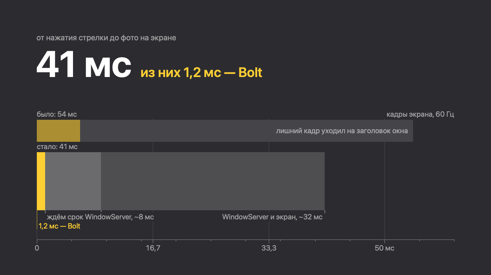
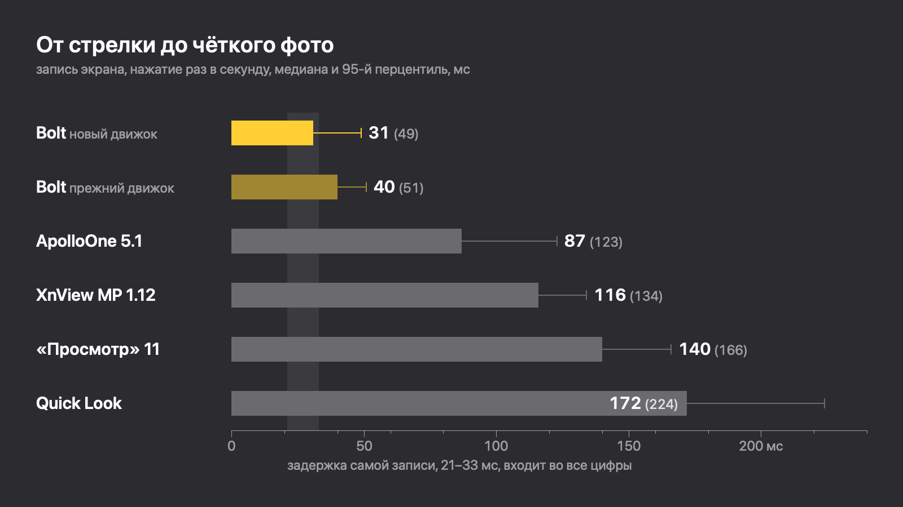

# От стрелки до фото 41 мс, из них 1,2 мс наши: как устроен просмотрщик фото для macOS

Я импортировал со своего айфона большую пачку фотографий в HEIC. Оказалось, что даже на современном макбуке листать их нечем. Встроенный «Просмотр» и сторонние бесплатные программы показывали следующее фото с задержкой. Сами программы тоже открывались не сразу: между двойным кликом в Finder и фотографией на экране проходило заметное время.

Платные просмотрщики я тогда не смотрел. Мне кажется, платный просмотрщик — это зло.

Раньше ради таких задержек никто бы не стал заморачиваться и писать свой просмотрщик, и я бы не стал. Но мы живём в эпоху крутых агентов, и я понял, что можно написать своё решение. Код написал ИИ-агент, Claude Code. Я ставил задачу и принимал работу.

Получился Bolt, нативный просмотрщик на Swift и AppKit без сторонних зависимостей. Задачу по скорости я поставил так: смысл не в том, чтобы листать больше фотографий в секунду при зажатой стрелке, а в том, чтобы после нажатия стрелки прошло как можно меньше времени до следующей фотографии.

В наших с агентом замерах Bolt листает быстрее «Просмотра», Quick Look, XnView MP и ApolloOne. Ближайший из них, ApolloOne, показывает следующее фото в два с лишним раза медленнее. Photo Mechanic, FastRawViewer и другие программы мы не проверяли.



*Время от события клавиши в приложении до момента, когда система показала кадр. Медиана по 111 нажатиям на HDR-фото, экран 60 Гц. Жёлтое — работа Bolt, серое — ожидание и путь кадра через WindowServer, системный процесс, который собирает кадр экрана из окон всех программ.*

На картинке главный результат. От нажатия стрелки до фото на экране проходит 41 мс. Bolt из них занимает 1,2 мс: столько идёт от нажатия до команды «показать кадр». Всё остальное время кадр идёт к экрану через macOS, и сократить этот путь у нас не получилось.

Движок, о котором эта статья, уже лежит в основной ветке репозитория. Прежний движок остался в сравнении: в таблице ниже у него отдельный столбец.

<cut />

## Что это за программа

В части UX я вдохновлялся IrfanView, программой, знакомой многим по Windows. Она выходит с 1996 года, и на её сайте до сих пор написано: «Fast and compact (just 8 MB)». Мне хотелось перенести на Mac похожий опыт: открыл одно фото, листаешь всю папку, и всё делается с клавиатуры минимальным количеством нажатий.

Программа получилась очень простая. Delete отправляет фото в Корзину и сразу показывает следующее. Диалога подтверждения нет, зато любое действие с файлом отменяется через ⌘Z. Цифры от 1 до 9 перемещают фото в назначенные папки. Квадратные скобки поворачивают фото, при этом меняется только тег Orientation, а пиксели остаются байт в байт. Есть экспорт по пресету и пакетные операции: конвертация, изменение размера, переименование по шаблону. Клавиши привязаны к физическим кодам, поэтому работают и в русской раскладке.

Ещё есть сетка, в которой видны все фото папки.

(GAP 1: скриншот окна Bolt с вашим настоящим фото)

Bolt не инструмент для каталогизации. Он не заменяет Lightroom и другие программы, которые ведут библиотеку ваших фотоальбомов. Он работает на уровне папки, и его сила в простоте. Свои фото я раскладываю по папкам. Мне кажется, такой подход отказоустойчивее и ни от чего не зависит. Полноценный редактор Bolt тоже не заменяет.

Теперь я пользуюсь им каждый день и поставил просмотрщиком по умолчанию.

## Как меряли

Чужую программу нельзя попросить сообщить, когда она показала кадр. Поэтому бенчмарк смотрит на экран. Он записывает экран через ScreenCaptureKit, сам нажимает клавиши и ищет в записи момент, когда появилось нужное фото.

Фото настоящие: 202 штуки из моего архива с iPhone 13, каждое двенадцатое из 2435. У 193 из них есть карта усиления (gain map): второе изображение внутри HEIC, которое говорит, где и насколько поднять яркость. На экране с запасом яркости такие фото показываются как HDR. Запас яркости — это то, во сколько раз экран может светить ярче обычного белого. У этого макбука он равен 2,0. Ниже будет видно, почему это важно.

Узнавать фото в записи помогает эталон. В конце своего круга бенчмарк проходит в той же программе по всем показанным фото, ждёт на каждом 0,6 секунды и запоминает установившуюся картинку. Кадр записи считается чётким, когда деталей на нём не меньше 0,9 от эталона, а яркость отличается не больше чем на 2 уровня из 255. Превью, встроенная в файл уменьшенная копия фото, этот порог не проходит: оно размытое.

Программ шесть: Bolt с новым движком, Bolt с прежним движком, ApolloOne 5.1, XnView MP 1.12.2, «Просмотр» 11 и Quick Look. ApolloOne платный, мерили его пробную версию. Новый движок — это три изменения, о которых дальше: отдельная транзакция для фото, декодер на Core Image и чёткий кадр на каждом шаге листания. Прежний движок — это Bolt до этих изменений. Окно у всех 1400 × 870. Каждую программу гоняли три круга в перемешанном порядке. Компьютер один: MacBook Air 15″ с Apple M5 и 16 ГБ памяти, macOS 27, экран 60 Гц.

В таблицу ниже вошли пять сценариев. В трёх стрелку нажимают 90 раз: раз в секунду, раз в 400 мс и раз в 150 мс. В четвёртом стрелка зажата на три секунды. Первое повторение приходит через 500 мс, дальше нажатия идут каждые 83 мс, как при системном автоповторе. В пятом программа закрыта, и бенчмарк открывает в ней файл из Finder.



*Нажатие раз в секунду. Полоса показывает медиану, тонкая линия — 95-й перцентиль.*

Все цифры в таблице — медиана, в скобках 95-й перцентиль, в миллисекундах.

| | Bolt, новый движок | Bolt, прежний движок | ApolloOne⁷ | XnView MP | «Просмотр» | Quick Look |
|---|---:|---:|---:|---:|---:|---:|
| Нажатие раз в 1000 мс | 31 (49) | 40 (51) | 87 (123) | 116 (134) | 140 (166) | 172 (224) |
| Раз в 400 мс | 26 (36) | 40 (50) | 64 (84) | 107 (131) | 123 (145) | 167 (247) |
| Раз в 150 мс | 27 (35) | 38 (47) | 64 (85) | 229 (486)¹ | 156 (247)¹ | 197 (238)¹ |
| Зажатая стрелка, фото в секунду | 10,3 | 10,3 | 6,2 | 2,7 | 6,7 | 0,3² |
| Сколько из них чётких | 100% | 35% | 100% | 100% | 6% | —² |
| После отпускания до чёткого кадра | 0 | 192 | 137 | 780 | 407 | —² |
| Открытие из Finder, фото появилось | 291 (872) | 252 (609) | 2119 (3326)³ | 674 (1140) | 2300 (7765)⁴ | 237 (649)⁵ |
| Открытие из Finder, чёткий кадр | 350 (1938)⁶ | 435 (742) | 2119 (3623)³ | 674 (1140) | 8250 (13457)⁴ | 637 (1016)⁵ |

1. Эти программы не успевают. У XnView MP на 59 нажатиях из 90 картинка не сменилась до следующего нажатия. У «Просмотра» на 50 нажатиях из 90 фото не стало чётким. Quick Look на 29 нажатиях из 90 не показал фото.
2. При синтетическом автоповторе Quick Look остался на одном фото, хотя выделение в Finder двигалось. На живой клавиатуре это не проверено, вывода здесь нет.
3. Вместе с запуском программы и проверкой пробной версии.
4. «Просмотр» листает только файлы, открытые вместе, поэтому ему открывали все 202 сразу. В его время входит загрузка всех файлов, и с остальными оно напрямую не сравнимо.
5. Quick Look открывали пробелом в уже открытом окне Finder. Программу он не запускает.
6. Это история с яркостью HDR, о ней ниже.
7. Листание и зажатая стрелка у ApolloOne посчитаны по двум кругам из трёх. В первом у него была открыта лента миниатюр, и 57 нажатий из 90 не сменили фото.

При листании новый движок быстрее всех, кого мы мерили, а при зажатой стрелке идёт наравне с прежним. Его 95-й перцентиль ниже медианы любой из четырёх чужих программ. При открытии из Finder он не первый. Фото раньше появляется у Quick Look, через 237 мс, и у прежнего движка, через 252 мс, против 291 мс. И в худших случаях чёткий кадр при открытии приходит у него позже, чем у прежнего движка, Quick Look и XnView MP. Это история с яркостью HDR, о ней ниже.

У таблицы несколько оговорок.

- Нажатия синтетические. На живой клавиатуре цифры могут отличаться.
- Задержка самой записи экрана, 21–33 мс, входит во все цифры одинаково. Таблица годится для сравнения программ между собой, а не как абсолютное время «нажал и увидел».
- Шесть программ мерили на сборке до починки яркости, о которой ниже. После починки листание перепроверили замером внутри приложения в двух сценариях, оно не изменилось. Экранную серию не повторяли.
- От серии к серии цифры плавают, поэтому сравнивать стоит только программы внутри одной серии.

С задержкой записи вышла ошибка. Бенчмарк калибрует задержку так: в известный момент меняет цвет фона за окнами и ищет эту смену в записи. В первой версии отчёта агент вычел задержку из результата Bolt и получил около 17 мс, примерно один кадр экрана. Так считать нельзя. Смена цвета фона идёт к экрану тем же путём через WindowServer, что и кадр любой программы. Вычитание убирало вместе с записью часть настоящего времени. Абсолютное время пришлось мерить иначе.

## 41 мс: из чего они состоят

Чтобы узнать время от нажатия до экрана без записи, агент встроил в Bolt зонд. Зонд посылает приложению событие клавиши. Вместе с фото, в той же транзакции Core Animation, он кладёт в окно слой Metal размером 2 пункта. Транзакция — это пакет изменений слоёв, который приложение отправляет в WindowServer за один раз. У слоя Metal можно спросить `presentedTime`, момент показа кадра. Это время назначает система, а не приложение. Замер шёл на фото, которые уже лежат в кэше.

Первый результат был 54 мс. Приложение тратило из них 6 мс, остальное время кадр шёл к экрану.

Потом нашлось лишнее время: фото приходило на экран на кадр позже, чем могло. Bolt отправлял фото в одной транзакции с заголовком окна, значком файла в заголовке и строкой состояния, и AppKit раскладывал и рисовал их текст внутри этой транзакции. Агент по очереди убирал их оттуда и смотрел, как меняется время до экрана.

| Что убрано из транзакции с фото | До экрана, медиана / p95, мс |
|---|---:|
| Ничего | 55,6 / 63,0 |
| Только заголовок окна | 46,1 / 53,8 |
| Только значок файла | 53,6 / 60,6 |
| Только строка состояния | 52,2 / 58,1 |
| Все три | 42,7 / 49,3 |

*Отдельная серия из 37 нажатий, поэтому числа на 1–2 мс отличаются от итоговых.*

Виноват в основном заголовок окна. Главному потоку его смена стоит около 1 мс, а без него фото приходит на экран на 9,5 мс раньше. Без всех трёх оно приходит раньше на 13 мс, почти на целый кадр. Теперь фото уходит своей транзакцией и первым. Заголовок и строка состояния идут в следующей.

```swift
CATransaction.begin()
CATransaction.setDisableActions(true)
imageLayer.contents = newFrame.layerContents
// ...
CATransaction.commit()
// Фото уходит в WindowServer отдельной транзакцией.
// Заголовок и строка состояния идут следом, максимум на кадр позже.
if window?.isVisible == true { CATransaction.flush() }
```

После этого от события клавиши до кадра на экране стало 41,4 мс вместо 54,1 мс. 95-й перцентиль стал 49,3 мс вместо 61,6 мс. Эти 41 мс делятся на три части:

- 1,2 мс проходит от события клавиши до транзакции с фото. Это вся работа Bolt. Раньше здесь было 6 мс: в них входили раскладка и отрисовка заголовка и строки состояния.
- От 0 до 16,7 мс, в среднем около 8 мс, кадр ждёт срока, к которому WindowServer собирает следующий кадр экрана.
- Ещё 31–34 мс проходит от этого срока до показа. При 60 Гц это около двух кадров.

За пределами 41 мс остаются путь от клавиатуры до приложения и развёртка кадра панелью. По оценке агента это 1–5 мс и около 8 мс плюс отклик панели. Их не мерили.

Получается, приложение управляет 1,2 мс из 41. Агент проверил, можно ли сократить остальное. Показ фото через Metal вместо `contents` дал 43,4 мс против 41,4 мс. Соседние кадры, заранее положенные в дерево слоёв, сократили транзакцию на 0,7 мс, а на экране ничего не изменили. Вывод отчёта такой: в окне этот путь не обойти ни через `contents`, ни через Metal.

В таблице сравнения у Bolt 31 мс, а здесь 41 мс. Это разные часы. В таблице отсчёт идёт от синтетического нажатия до кадра в записи экрана. Здесь он идёт от события клавиши в приложении до отметки системы о показе. Запись экрана, судя по калибровке, видит кадр раньше, чем его покажет панель. Смену цвета фона запись замечает через 21–33 мс после команды, а по отметке системы кадр идёт до экрана 40 мс. Поэтому таблица годится для сравнения программ, а абсолютное время даёт только зонд.

## Декодер: 151 мс и 17 мс

Чёткий кадр должен лежать в кэше до нажатия, а для этого его надо успеть декодировать. На настоящих фото с этим оказалось плохо.

Первые замеры Bolt шли на синтетических фото без карты усиления, и цифры в них были хорошие. А на настоящих фото с айфона Bolt не казался мне быстрее «Просмотра». Причина нашлась в декодере. Без HDR системный ImageIO декодирует фото за 45–47 мс. У настоящих фото с айфона карта усиления есть, и на экране с запасом яркости ImageIO декодирует их как HDR. На это уходило 140–151 мс на фото. Потоки не помогали.

| Потоков | 1 | 2 | 4 | 6 | 8 |
|---|---:|---:|---:|---:|---:|
| ImageIO, HDR, фото в секунду | 6 | 10 | 11 | 7 | 11 |
| Core Image, HDR, фото в секунду | 59 | 88 | 112 | 117 | 118 |

Профиль показал, куда уходит время. Сам HEVC декодируется аппаратно. Айфонный HEIC на 12 Мп состоит из 48 плиток размером 512 × 512. Системный фреймворк CMPhoto для каждой плитки заново создаёт сессию преобразования пикселей, `VTPixelTransferSession`, и каждый раз спрашивает WindowServer про основной экран. Микротест это подтвердил: 48 плиток с новой сессией на каждую занимают 23,4 мс, а с одной общей сессией 11,0 мс. В профиле HDR-фото у вспомогательного потока CMPhoto такой работы примерно в 2,6 раза больше, чем в профиле обычного.

Core Image идёт другим путём. Судя по стекам, он получает от CMPhoto всё фото целиком и делает преобразование цвета и масштабирование за один проход на GPU. Новый декодер Bolt строит `CIImage` из того же файла, применяет карту усиления под запас яркости экрана и рендерит результат в `IOSurface`. Слой показывает эту поверхность без копирования.

```swift
var image = CIImage(cgImageSource: source, index: 0, options: [.applyOrientationProperty: true])
// ...
let gainMap = CIImage(cgImageSource: source, index: 0,
                      options: [.applyOrientationProperty: true, .auxiliaryHDRGainMap: true])
// ...
image = image.applyingGainMap(gainMap, headroom: Float(headroom))
// ... масштаб под экран, затем рендер в IOSurface
try context.startTask(toRender: image, to: destination).waitUntilCompleted()
```

Один кадр теперь декодируется за 16–17 мс вместе с HDR. В лабораторном стенде на четырёх потоках это 110 фото в секунду в минутном прогоне. Результат агент сверил со старым путём на 400 фото: размер и ориентация совпали на всех. ImageIO остался для PNG, GIF, TIFF, RAW, анимаций и полного кадра при зуме. К нему же Bolt возвращается, когда Core Image не справился: это CMYK, оттенки серого и HDR без карты усиления.

Две идеи агент проверил и отложил. Прототип своего декодера на VideoToolbox показал потолок железа: 147 фото в секунду, и это только декодирование плиток, без сборки и масштабирования. Core Image без HDR даёт 131. Выигрыш был бы не больше 12%, и строить такой декодер не стоило. Добавлять потоки ImageIO тоже бессмысленно: без HDR он даёт 38 фото в секунду на двух потоках и 40 на шести.

## Листание: чёткий кадр на каждом шаге

По нажатию стрелки Bolt сдвигает индекс в списке, берёт из кэша готовый кадр этого фото и кладёт его в `contents` слоя. Отрисовки в приложении нет. Показ кадра — это одна замена содержимого слоя с выключенной анимацией.

Кадр оказывается в кэше заранее. Bolt декодирует три фото вперёд по направлению движения и одно назад. Глубину «вперёд» подобрали замером при автоповторе каждые 16 мс. С двумя фото вперёд чёткий кадр сразу был на 87–98% шагов, с тремя на 98–100%. С пятью он был на всех шагах, но память процесса вырастала ещё на 100 МБ.

В прежнем движке был отдельный режим для зажатой стрелки. Bolt показывал в нём только превью, а чёткий кадр декодировал после отпускания. На HDR-фото ImageIO выдавал максимум 11 фото в секунду. Автоповтор просит 12, так что успеть декодер не мог. С декодером на 17 мс режим стал не нужен, и в новом движке его нет. Теперь чёткий кадр есть на каждом шаге.

| Автоповтор каждые | 90 мс | 60 мс | 33 мс | 16 мс |
|---|---:|---:|---:|---:|
| Шагов с чётким кадром сразу, с режимом превью | 99–100% | 4% | 4% | 4% |
| Без него, с новым декодером | 100% | 100% | 100% | 99–100% |

Автоповтор каждые 16 мс — это 62 фото в секунду. По замеру внутри приложения после отпускания клавиши чёткий кадр раньше появлялся через 211–217 мс. Теперь он уже на экране.

У быстрого декодера нашлась цена. HDR-кадр хранится в формате half float и занимает 29 МБ для вертикального фото и 52 МБ для горизонтального. Прежние кадры занимали 14–26 МБ. Освобождение большого кадра стоило главному потоку миллисекунды на каждом шаге, поэтому вытесненные кадры теперь освобождает фоновая очередь. Кэш при этом держит только запрошенное: текущее фото, одно назад и три вперёд. Раньше в нём лежал 21 кадр. В итоге максимум памяти процесса не вырос: 388 МБ против 398 МБ.

Одно решение принято не ради скорости. Bolt не оставляет на экране предыдущее фото, пока грузится следующее. Если кадра ещё нет, окно пустое. Иначе можно нажать Delete, глядя на одно фото, и отправить в Корзину другое.

## HDR: две находки по дороге

Экранный бенчмарк сравнивает с эталоном не только детали, но и яркость. Это дважды вывело на ошибки, которые никто не искал.

Первая находка. На одном и том же фото прежний движок дал средний уровень 67,5, а новый 97,0. Агент снял пять HDR-фото в четырёх программах. Прежний движок показывал их темнее «Просмотра» и Quick Look на 30–38 уровней из 255. Что именно не так в прежнем пути, в отчёте не разобрано. Новый движок на трёх фото из пяти совпадает с ними в пределах 1,4 уровня. На двух самых светлых он светлее на 6 уровней. Фото без карты усиления все четыре программы показывают одинаково.

Вторая находка началась как «медленное первое открытие». В серии замеров новый движок дважды показал чёткий кадр только через 1,3 и 1,9 секунды после открытия. Декодер при этом не опаздывал. Чёткий кадр приходил через 0–33 мс после превью. Но приходил он на 9 уровней темнее итогового и потом около секунды плавно светлел. Бенчмарк ждёт яркость в пределах 2 уровней от эталона, поэтому он ждал всю эту секунду. Повторялось это только после паузы в 15 секунд.

Причина оказалась в слое. Он сводил яркость кадра к запасу яркости, который экран даёт в текущий момент. Экран, на котором давно не было HDR, поднимает запас с 1,0 до 2,0 примерно за секунду. Кадр из Core Image уже отрендерен под запас 2,0, и сводить его не нужно. Починка заняла одну строку.

```swift
imageLayer.toneMapMode = fitsScreenHeadroom ? .never : .ifSupported
```

До итоговой яркости стало 33 мс вместо 1033 мс, по одному замеру на сборку. Перед этим агент проверил другую гипотезу: запасное декодирование через ImageIO на случай, если кадр Core Image опаздывает. Оно ни разу не сработало: кадр Core Image не опаздывал. Строка открытия из Finder в таблице сравнения снята до этой починки.

Здесь две оговорки. Запись экрана идёт в sRGB с 8 битами на канал и яркость выше обычного белого не передаёт. Глазами на HDR-экране результат пока никто не сверял. И на экране с запасом яркости меньше 2,0 кадр теперь обрежется по светам, а не сожмётся. Это не мерили.

## Холодный старт: работать, пока занята система

Холодный старт здесь означает двойной клик по фото в Finder, когда Bolt не запущен. В Bolt встроен таймлайн запуска, он записывает время каждого шага от старта процесса. По нему видно, что до окна большая часть времени занята системой. До `main` проходит 37 мс, хотя сам бинарник при прямом запуске доходит до `main` примерно за 11 мс. Ещё около 50 мс занимает создание `NSApplication`. Сократить это время Bolt не может. Он может в это время работать на других ядрах. Приёмов три.

- Прогрев декодера. По замерам агента первый HEIC в жизни процесса декодируется примерно на 100 мс дольше следующих. В бандле лежит файл `warmup.heic`: 16 × 16 пикселей, 2324 байта. Bolt отправляет его на декодирование в самом начале `main`, ещё до создания `NSApplication`.
- Декодирование до окна. Конструктор окна сначала ставит в очередь чтение превью и декодирование чёткого кадра и только после этого создаёт вьюхи.
- Порядок на главном потоке. Пустое окно встаёт на сохранённое место до вставки содержимого, и переезд стоит 7–8 мс вместо 26 мс. Меню собирается после показа фото, это ещё около 11 мс.

```swift
MainActor.assumeIsolated {
    LaunchTimeline.mark("main")
    LaunchWarmUp.start()                     // декодирует warmup.heic на другом ядре
    let application = NSApplication.shared   // около 50 мс системной работы
    // ...
}
```

С новым декодером на настоящих фото чёткий кадр по таймлайну готов через 176 мс после старта процесса вместо 331 мс, по 12 запускам. В таблице сравнения у той же сборки 350 мс: там отсчёт идёт от команды открыть файл и до кадра в записи экрана.

### Оптимизация, которую убрали

В таймлайне между сборкой меню и приходом файла от Finder была дыра в 64 мс. Профиль показал, что в это время AppKit проверяет, доступны ли Writing Tools для меню «Правка», и загружает для этого фреймворк WritingToolsUI.

Агент попробовал загрузить этот фреймворк заранее, в фоновом потоке. Файл от Finder стал приходить на 9–18 мс раньше. Потом примерно за 60 запусков дважды случилась пауза в 1,1 секунды. В сборке без фоновой загрузки на 33 запуска не было ни одной.

Объяснение правдоподобное, но не доказанное. У загрузчика dyld общая блокировка. Пока фоновый поток загружает фреймворк, главный поток ждёт её внутри создания `NSApplication`, и в профиле это ожидание было видно. Агент убрал фоновую загрузку, и за следующие 15 запусков пауз не было.

Ещё четыре идеи не дали ничего: отложенное создание окна (`defer: true`), создание окна сразу в сохранённой рамке, отключение анимации окна и удаление таблицы символов из бинарника.

## Почему остальные медленнее

Этот раздел опирается на устройство программ. Бандлы XnView MP и «Просмотра» агент разобрал статически: какие библиотеки подключены, какие функции импортируются, какие права выданы. XnView MP он ещё снял профилировщиком `sample` при листании. «Просмотр» под профилировщиком не запускался, поэтому объяснения про него остаются гипотезами.

У XnView MP и «Просмотра» шире круг задач. XnView MP носит свои декодеры и одинаково работает на Windows, macOS и Linux. «Просмотр» открывает ещё и PDF и умеет аннотации. Листать папку с HEIC для них — побочная задача, а для Bolt — главная.

### XnView MP

XnView MP написан на Qt 6.8, его бандл весит 350 МБ. Профиль сняли так: программа работала в фоне и получала нажатие стрелки раз в 0,6 секунды. Под профилировщиком она работает медленнее обычного, поэтому я беру из профиля устройство, а не миллисекунды. Профиль показал четыре вещи.

- HEIC декодирует программный декодер libde265 из libheif 1.23.4. Вызовов ImageIO и VideoToolbox в стеках нет.
- Вокруг каждого декодирования libheif загружается через `dlopen` и выгружается через `dlclose`.
- Часть декодирований идёт на главном потоке: он стоит в `heif_decode_image` и ждёт рабочие потоки. Остальные делает отдельный поток `MyPreviewThread`. Судя по имени потока и настройкам, это опция «Read one image ahead».
- Полный кадр 12 Мп XnView уменьшает до размера окна сам, функцией `BitmapDisplay::qScale`, в `paintEvent` на главном потоке. Времени главного потока на это ушло почти столько же, сколько на загрузку фото.

Вперёд XnView читает одно фото. Судя по его форуму, глубина не настраивается. С таблицей это сходится: при нажатии раз в секунду следующее фото, видимо, успевает декодироваться заранее, а при нажатии раз в 150 мс запаса не хватает, и отставание копится. Bolt читает вперёд три фото, но у него одно фото стоит 17 мс.

### «Просмотр»

У «Просмотра» при нажатии раз в секунду 140 мс. На 83 нажатиях из 90 он сначала показывает размытый кадр и только потом чёткий. При зажатой стрелке он меняет 6,7 фото в секунду, но чётких среди них 6%. После отпускания чёткий кадр приходит через 407 мс.

Почему так, я не установил. Известно, что фото он показывает через универсальную вьюху из ImageKit с зумом и аннотациями и, судя по импортам, декодирует через системный ImageIO. Тот же ImageIO в замерах Bolt тратил на HDR-фото 140–151 мс. Цифры похожи, но связаны ли они, я не проверял.

Листать папку «Просмотр» не умеет. Отчасти это следует из его устройства: он работает с документами и живёт в песочнице. По документации Apple, открытие файла расширяет песочницу на этот файл, а не на его папку. После двойного клика по одному фото у «Просмотра», судя по всему, нет права прочитать соседние. Но к папке «Загрузки» доступ у него есть, а папку он не листает и там. Видимо, так решили в Apple.

### Quick Look и ApolloOne

Устройство этих двух программ агент не разбирал, у меня есть только цифры. Quick Look программу не запускает, поэтому при открытии показывает фото первым. При нажатии раз в секунду и раз в 400 мс он медленнее всех: 172 и 167 мс. ApolloOne ближе всех к Bolt: 87 мс при нажатии раз в секунду и 64 мс при более частых.

## Вайб-кодинг и маленькие утилиты

Bolt закрывает маленькую нишу. Просмотрщик фото есть в каждой системе, сторонних хватает, и разница между ними — от десятков миллисекунд при листании до секунд при открытии. Раньше ради такой разницы никто бы не стал заморачиваться. Только в этой статье десять идей, которые не дали ничего, не окупились или навредили. Каждую надо было собрать, замерить и сравнить. Ещё понадобились бенчмарк, который меряет чужие программы по записи экрана, зонд внутри приложения, разбор чужих бандлов и профиль XnView MP.

Агент при этом ошибался. Первый бенчмарк мерил синтетические фото и пропустил медленный путь HDR. Разницу я заметил глазами, на своих фото. Про вторую ошибку, с вычитанием задержки записи, я рассказал выше.

С вайб-кодингом такие вещи делать можно. Особенно хорошо он работает на компактных утилитах. В Bolt около 10 тысяч строк и нет зависимостей, раздутой кодовой базой Bolt не страдает. Про большие проекты я здесь ничего не утверждаю: мой пример — утилита.

Мне кажется, незаполненных ниш такого размера ещё много.

## Чего нет и что не проверено

- Все замеры сделаны на одном Mac с экраном 60 Гц, нажатия в них синтетические. На экране 120 Гц мы не мерили.
- Photo Mechanic, FastRawViewer и другие просмотрщики мы не мерили.
- HDR сверен только по записи экрана. Глазами на HDR-экране и на экране с запасом яркости меньше 2,0 его не проверяли.
- Объяснения про «Просмотр» — выводы из статического разбора, профиль с него не снимали. Профиль XnView MP снят на синтетических фото при нажатии раз в 0,6 секунды.
- Нет экспорта в WebP: ImageIO его читает, но не пишет.
- Нет поиска дублей, гистограммы и фокус-пикинга.

Код под лицензией MIT: (GAP 2: ссылка на репозиторий и команда запуска бенчмарка). Бенчмарк лежит там же. Готовой сборки нет. Приложение подписано ad hoc, без Developer ID и нотаризации, поэтому его нужно собирать из исходников: `scripts/build-app.sh`. Хватает Command Line Tools, Xcode не нужен.
